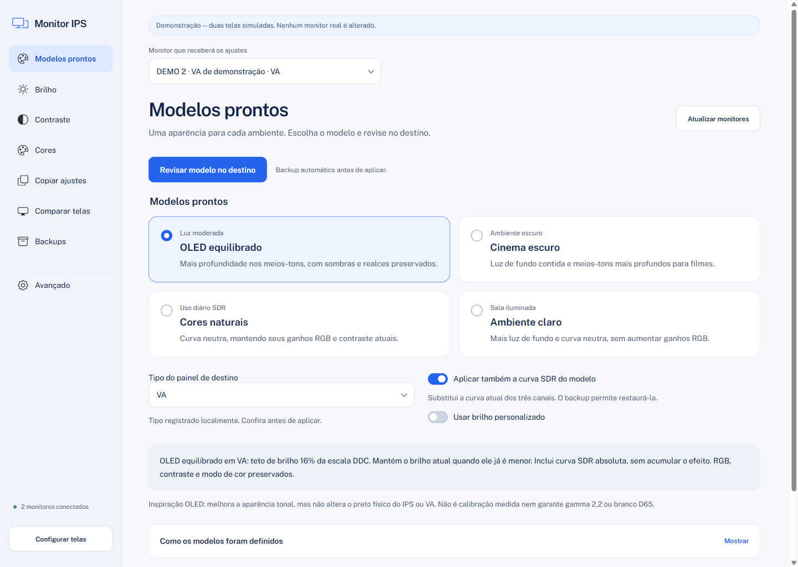

<p align="center">
  
</p>

<h1 align="center">Monitor IPS</h1>

<p align="center">
  Your displays, your way. Adjust brightness, contrast and colors on Windows, with review and backup before applying.
</p>

<p align="center">
  <a href="#get-started">Get started</a>
  |
  <a href="#features">Features</a>
  |
  <a href="#documentation">Documentation</a>
  |
  <a href="#development">Development</a>
  |
  <a href="README.md">Português</a>
</p>



Monitor IPS is a local Windows application for adjusting the appearance of IPS and VA monitors. Use ready-made presets, adjust one control per screen, or copy settings from a reference display to a destination.

It is designed for people who use multiple displays, want to try a different appearance, or prefer controlling settings from their computer. Prepare changes, review the preview, then confirm the application. The screenshot shows the Brazilian Portuguese interface with simulated monitors.

## Features

- **One function per screen.** Guided setup, a sidebar, and separate screens for brightness, contrast, colors, comparison and backups.
- **Presets for different environments.** OLED equilibrado, Cinema escuro, Cores naturais and Ambiente claro, with optional custom brightness.
- **Your IPS as a reference.** Copy current settings using exact values or values proportional to each monitor's range.
- **Review before applying.** Editing a slider prepares a draft. Sending changes to a monitor requires confirmation.
- **Backup and verification.** Readable destination settings are saved before writing; controls are read again to verify the result.
- **Visual comparison.** Black, shadow, highlight and grayscale patterns help you assess both displays.
- **Optional SDR curves.** Midtone and shadow adjustments have their own Advanced screen and are blocked when SDR cannot be confirmed.
- **GUI and CLI.** Use the Electron window or Python commands to suit your workflow.

## Usage modes

| Mode | Best for | How it works |
| --- | --- | --- |
| Desktop app | Visual controls | Guided setup, individual adjustments, presets and review before applying. |
| CLI | Terminal use and automation | Python commands with preview, confirmation and JSON output where supported. |
| Demo | Exploring the project | Simulated monitors without reading or changing real hardware. |

## Local and under your control

The interface communicates with a Python process over standard input and output. It requires no account or HTTP server. Once dependencies are prepared, application features run locally.

Backups are versioned JSON files on your computer. Create a manual backup, restore a compatible file, or undo the last application in the current session. Restoration also requires review and confirmation.

**An aesthetic adjustment is not measured calibration.** This application does not turn IPS or VA panels into OLED. Equal settings can produce different images; OLED-inspired presets do not change physical black levels or certify gamma, luminance or a D65 white point. See [compatibility and limitations](documents/USER-GUIDE.md#limitações) in the Portuguese guide.

## Get started

1. Prepare the environment using the commands below.
2. Run the demo to explore the interface without accessing your monitors.
3. For real use, enable DDC/CI in the monitor's menu and launch with `npm start`.
4. Select the reference and destination in guided setup. IPS/VA classification relies on the user's identification.
5. Choose a function, review the changes, and confirm when ready.

### Requirements

| Requirement | Version or condition |
| --- | --- |
| System | Windows 10 or 11 |
| Python | 3.10 or newer, available through the `python` command |
| Node.js | 22.12 or newer with npm, for the Electron interface |
| Git | For cloning; alternatively, download the source ZIP from GitHub |
| Monitor | DDC/CI enabled for hardware controls; support varies by monitor and connection |
| GPU curve | Confirmed SDR and compatible topology; HDR/WCG block this feature |
| Internet | Required for the initial dependency setup |

### Installation

Open PowerShell and obtain the source code:

```powershell
git clone https://github.com/MaxsuelOliveira/monitor-ips.git
cd monitor-ips
npm ci
npm run prepare:desktop
npm run demo
```

To use real monitors after exploring the demo:

```powershell
npm start
```

The `abrir.cmd` and `abrir_monito.cmd` launchers in the project folder also open the interface. The CLI needs neither Node.js nor Electron and requires no external Python packages:

```powershell
python monitor_ips.py --help
python monitor_ips.py --demo list --json
```

The full workflow is described in the [user guide](documents/USER-GUIDE.md), currently in Portuguese. The legacy Tkinter interface remains available through `python monitor_ips.py gui-tk`.

## Documentation

The following detailed guides are currently in Portuguese:

| Guide | Contents |
| --- | --- |
| [User guide](documents/USER-GUIDE.md) | Presets, copying, controls, backups, CLI and limitations. |
| [Development](documents/DEVELOPMENT.md) | Architecture, checks and the QA resource lifecycle. |
| [Preset research](documents/IMAGE-PRESETS-RESEARCH.md) | References, parameters and limits of aesthetic curves. |
| [Preset validation](documents/PRESETS-VALIDATION.md) | Recorded development scenarios and results. |
| [Desktop validation](documents/DESKTOP-VALIDATION.md) | Technical evidence for the Electron interface. |
| [README pattern](documents/README-TEMPLATE.md) | A reusable template and instructions for other projects. |

Validation reports describe checks in specific environments and do not guarantee compatibility with every monitor.

## Development

The interface uses Electron and HTML/CSS/JavaScript; the service and CLI use Python. The renderer is isolated and has no Node, shell or hardware access. Write operations are prepared by the backend and applied through a single-use token.

| Command | Purpose |
| --- | --- |
| `npm run demo` | Open the interface with simulated monitors. |
| `npm test` | Check Electron client integration with the Python backend. |
| `npm run check` | Check JavaScript module syntax. |
| `python -m unittest discover -s tests -v` | Run the Python suite. |
| `python -m compileall -q monitor_ips.py monitor_tool tests scripts` | Check Python module compilation. |

For screenshots and interaction testing, follow the [QA procedure](documents/DEVELOPMENT.md#desenvolvimento-e-validação). Write tests use demo mode; real hardware requires specific authorization.

## Repository map

| Path | Responsibility |
| --- | --- |
| `desktop/` | Electron window, navigation, controls, styles and RPC client. |
| `monitor_tool/` | Shared service, CLI, DDC/CI, SDR curves and legacy Tkinter interface. |
| `monitor_ips.py` | Python command entry point. |
| `tests/` | Service, backend and desktop integration tests. |
| `scripts/` | Validation and QA utilities. |
| `documents/` | Guides, references, evidence and documentation images. |

## Contributing

When reporting an issue, describe the action, the expected result and the actual result. Include your Windows version, monitor model, connection type and affected controls. Remove personal information and private paths from logs and screenshots.

For proposed changes, preserve preview, confirmation, backup and verification. Run relevant checks and test writes in demo mode. Development rules are in [AGENTS.md](AGENTS.md).

## Licensing

A distribution license for Monitor IPS's own code has not been selected yet.

Third-party components retain their licenses and attribution: [third-party notices](THIRD_PARTY_NOTICES.md), [application assets](desktop/assets/SOURCES.md) and [documentation assets](documents/assets/SOURCES.md).

This README follows the visual composition of [Cap](https://github.com/CapSoftware/Cap#readme), using Monitor IPS text, identity and images.
