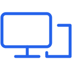
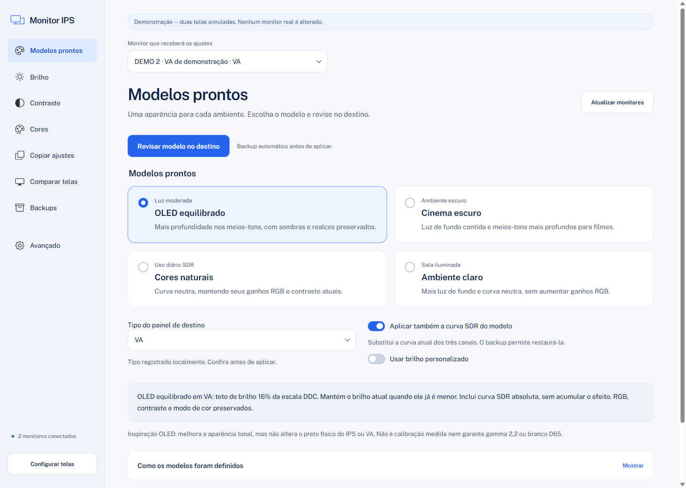

<p align="center">
  
</p>

<h1 align="center">Monitor IPS</h1>

<p align="center">
  Suas telas, do seu jeito. Ajuste brilho, contraste e cores no Windows, com revisão e backup antes de aplicar.
</p>

<p align="center">
  <a href="#começar">Começar</a>
  |
  <a href="#recursos">Recursos</a>
  |
  <a href="#documentação">Documentação</a>
  |
  <a href="#desenvolvimento">Desenvolvimento</a>
  |
  <a href="README.en.md">English</a>
</p>



O Monitor IPS é um aplicativo local para Windows que ajuda a ajustar a aparência de monitores IPS e VA. Use modelos prontos, ajuste um controle por tela ou copie configurações de um monitor de referência para outro.

Foi feito para quem usa mais de uma tela, quer experimentar uma aparência diferente ou prefere controlar os ajustes pelo computador. Você prepara as mudanças, confere a prévia e confirma a aplicação. A imagem acima usa monitores simulados.

## Recursos

- **Uma função por tela.** Configuração guiada, menu lateral e telas separadas para brilho, contraste, cores, comparação e backups.
- **Modelos para cada ambiente.** OLED equilibrado, Cinema escuro, Cores naturais e Ambiente claro, com opção de brilho personalizado.
- **Seu IPS como referência.** Copie valores atuais para o destino, com modo exato ou proporcional às escalas dos monitores.
- **Revise antes de aplicar.** Editar um slider prepara um rascunho. O envio ao monitor exige confirmação.
- **Backup e verificação.** O estado legível do destino é salvo antes da escrita; os controles são relidos para verificar o resultado.
- **Comparação visual.** Padrões de preto, sombras, realces e cinza ajudam a avaliar as duas telas.
- **Curvas SDR opcionais.** Ajustes de meios-tons e sombras ficam separados em Avançado, com bloqueio quando SDR não puder ser confirmado.
- **Interface e CLI.** Use a janela Electron ou os comandos Python, conforme seu fluxo.

## Modos de uso

| Modo | Para quem | Como funciona |
| --- | --- | --- |
| Aplicativo | Quem prefere controles visuais | Configuração guiada, ajustes individuais, modelos e revisão antes de aplicar. |
| CLI | Quem prefere terminal ou automação | Comandos Python com prévia, confirmação e saída JSON nas operações disponíveis. |
| Demonstração | Quem quer conhecer o projeto | Monitores simulados, sem leitura ou alteração do hardware real. |

## Local e no seu controle

A interface se comunica com um processo Python por entrada e saída padrão. Não exige conta nem servidor HTTP. Após preparar as dependências, os recursos do aplicativo funcionam localmente.

Backups são arquivos JSON versionados no computador. Você pode criar uma cópia manual, restaurar um arquivo compatível ou desfazer a última aplicação da sessão. A restauração também passa por revisão e confirmação.

**Ajuste estético não é calibração medida.** O aplicativo não transforma IPS ou VA em OLED. Valores iguais podem produzir imagens diferentes; modelos de inspiração OLED não alteram o preto físico nem certificam gamma, luminância ou branco D65. Veja [compatibilidade e limitações](documents/USER-GUIDE.md#limitações).

## Começar

1. Prepare o ambiente com os comandos abaixo.
2. Execute a demonstração para conhecer a interface sem acessar seus monitores.
3. Para uso real, habilite DDC/CI no menu do monitor e abra com `npm start`.
4. Na configuração guiada, escolha a referência e o destino. O tipo IPS/VA depende da identificação do usuário.
5. Escolha uma função, revise as alterações e confirme quando estiver pronto.

### Requisitos

| Requisito | Versão ou condição |
| --- | --- |
| Sistema | Windows 10 ou 11 |
| Python | 3.10 ou superior, acessível pelo comando `python` |
| Node.js | 22.12 ou superior, com npm, para a interface Electron |
| Git | Para clonar o repositório; alternativamente, obtenha o código pelo download ZIP do GitHub |
| Monitor | DDC/CI habilitado para controles de hardware; suporte varia por monitor e conexão |
| Curva GPU | SDR confirmado e topologia compatível; HDR/WCG bloqueiam esse recurso |
| Internet | Necessária para a preparação inicial das dependências |

### Instalação

Abra o PowerShell e obtenha o código:

```powershell
git clone https://github.com/MaxsuelOliveira/monitor-ips.git
cd monitor-ips
npm ci
npm run prepare:desktop
npm run demo
```

Para usar os monitores reais após conhecer a demonstração:

```powershell
npm start
```

Na pasta do projeto, `abrir.cmd` e `abrir_monito.cmd` também abrem a interface. O CLI não precisa de Node.js ou Electron e não exige pacotes Python externos:

```powershell
python monitor_ips.py --help
python monitor_ips.py --demo list --json
```

O fluxo completo está no [guia de uso](documents/USER-GUIDE.md). A interface Tkinter anterior continua disponível com `python monitor_ips.py gui-tk`.

## Documentação

| Guia | Conteúdo |
| --- | --- |
| [Guia de uso](documents/USER-GUIDE.md) | Modelos, cópia, controles, backups, CLI e limitações. |
| [Desenvolvimento](documents/DEVELOPMENT.md) | Arquitetura, verificações e ciclo de vida do QA. |
| [Pesquisa dos modelos](documents/IMAGE-PRESETS-RESEARCH.md) | Referências, parâmetros e limites das curvas estéticas. |
| [Validação dos modelos](documents/PRESETS-VALIDATION.md) | Cenários e resultados registrados durante o desenvolvimento. |
| [Validação desktop](documents/DESKTOP-VALIDATION.md) | Evidências técnicas da interface Electron. |
| [Padrão de README](documents/README-TEMPLATE.md) | Modelo reutilizável e instruções para outros projetos. |

Os relatórios de validação registram verificações em ambientes específicos, não uma garantia de compatibilidade com qualquer monitor.

## Desenvolvimento

A interface usa Electron e HTML/CSS/JavaScript; o serviço e o CLI usam Python. O renderer é isolado e não possui acesso a Node, shell ou hardware. Operações de escrita são preparadas pelo backend e aplicadas por token de uso único.

| Comando | Finalidade |
| --- | --- |
| `npm run demo` | Abrir a interface com monitores simulados. |
| `npm test` | Validar integração do cliente Electron com o backend Python. |
| `npm run check` | Verificar a sintaxe dos módulos JavaScript. |
| `python -m unittest discover -s tests -v` | Executar a suíte Python. |
| `python -m compileall -q monitor_ips.py monitor_tool tests scripts` | Verificar a compilação dos módulos Python. |

Para capturas e testes de interação, siga o [procedimento de QA](documents/DEVELOPMENT.md#desenvolvimento-e-validação). Testes de escrita usam demonstração; hardware real exige autorização específica.

## Mapa do repositório

| Caminho | Responsabilidade |
| --- | --- |
| `desktop/` | Janela Electron, navegação, controles, estilos e cliente RPC. |
| `monitor_tool/` | Serviço compartilhado, CLI, DDC/CI, curvas SDR e interface Tkinter legada. |
| `monitor_ips.py` | Entrada dos comandos Python. |
| `tests/` | Testes de serviço, backend e integração desktop. |
| `scripts/` | Ferramentas auxiliares de validação e QA. |
| `documents/` | Guias, referências, evidências e imagens da documentação. |

## Contribuição

Ao relatar um problema, descreva a ação, o resultado esperado e o observado. Inclua a versão do Windows, o modelo do monitor, o tipo de conexão e os controles envolvidos. Remova dados pessoais e caminhos privados de logs e capturas.

Para propor mudanças, preserve o fluxo de prévia, confirmação, backup e verificação. Execute as validações relevantes e teste escritas em demonstração. As regras de desenvolvimento estão em [AGENTS.md](AGENTS.md).

## Licenciamento

A licença de distribuição do código próprio do Monitor IPS ainda não foi definida.

Componentes de terceiros mantêm suas licenças e atribuições: [avisos de terceiros](THIRD_PARTY_NOTICES.md), [assets do aplicativo](desktop/assets/SOURCES.md) e [assets da documentação](documents/assets/SOURCES.md).

A composição deste README segue a referência visual do [Cap](https://github.com/CapSoftware/Cap#readme), com textos, identidade e imagens do Monitor IPS.
